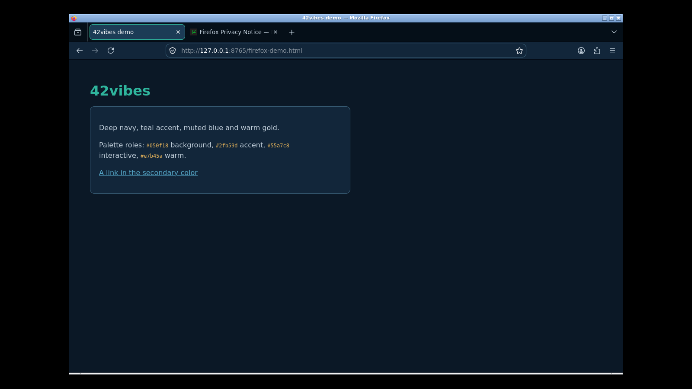
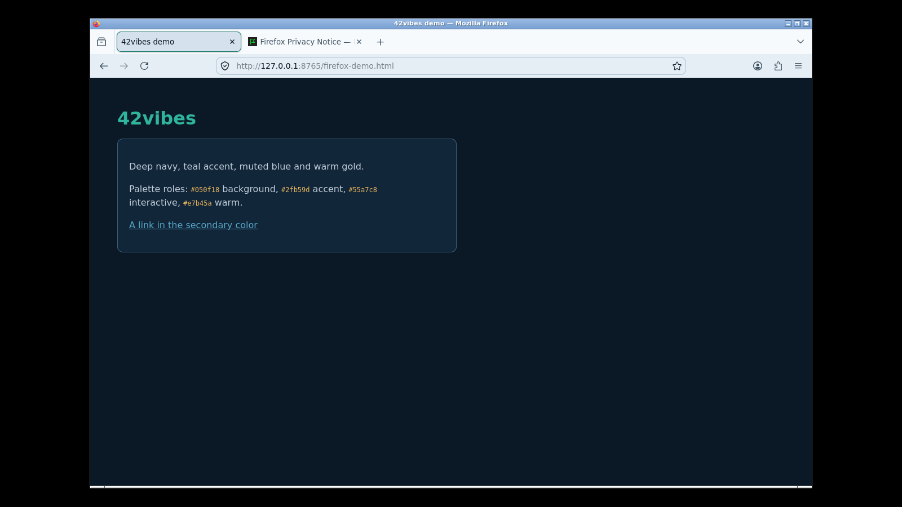

# 42vibes Firefox-Themes

**Deutsch** · [English](README.md)

Zwei eigenständige Firefox-Themes — **42vibes Dark** und **42vibes Light** — aus
der gemeinsamen [42vibes-Palette](vendor/palette.json). Firefox kann die Farben
eines Themes nicht automatisch umschalten, deshalb ist jeder Modus eine eigene
Erweiterung.

## Themes

| Ordner | `color_scheme` | Rahmen | Akzent |
| --- | --- | --- | --- |
| `firefox/42vibes-dark` | `dark` | `#050f18` | `#2fb59d` |
| `firefox/42vibes-light` | `light` | `#f7fafc` | `#177a69` |

Beide Themes färben Browser-Rahmen, Toolbars, Tabs, Adressleiste, Menüs, Sidebar
und die Neuer-Tab-Seite. Alle Werte stammen aus `semantic.*` und `ansi.*` in
`vendor/palette.json`.

## Screenshots

Echte Aufnahmen aus Firefox 153.7 (Linux, Xvfb), Theme über `about:debugging`
als temporäres Add-on geladen. Keine Automatisierungssitzung aktiv, daher ist
die Adressleiste nicht markiert.





## Installation

1. `about:debugging#/runtime/this-firefox` in Firefox öffnen.
2. **Temporäres Add-on laden…** anklicken.
3. `firefox/42vibes-dark/manifest.json` auswählen (oder die helle Variante).

Temporäre Add-ons verschwinden beim Neustart von Firefox. Für eine dauerhafte
Installation ist eine von AMO signierte Version nötig, siehe unten.

## Grenzen

Firefox-Themes sind kein vollständiger UI-Skin. Sie setzen Farben für Rahmen,
Toolbars, Tabs, Adressleiste, Popups, Sidebar und die Neuer-Tab-Seite und liefern
Icons für den Add-on-Manager. Interne Seiten wie `about:preferences` lassen sich
nicht umgestalten, Toolbar- und Tab-Layout nicht umsortieren und die Form von
Tabs und Buttons nicht ändern.

`userChrome.css` kann mehr, wird von Mozilla aber nicht unterstützt, gehört nicht
zu diesem Repository und bricht bei UI-Änderungen. Diese Themes sind reine
WebExtensions und brauchen es nicht.

Chromium/Chrome wird bewusst nicht abgedeckt.

## Veröffentlichung

Die Veröffentlichung auf [addons.mozilla.org](https://addons.mozilla.org) (AMO)
ist kostenlos. Themes, die dauerhaft installiert werden, müssen von Mozilla
signiert sein; AMO signiert sowohl gelistete als auch ungelistete
(selbst vertriebene) Themes. `make package` erzeugt die beiden ZIP-Dateien für
den Upload — `web-ext` wird nicht benötigt.

## Generierte Dateien

Jede `manifest.json` und jedes Icon wird von `build.py` erzeugt; bitte nicht von
Hand bearbeiten. Farben in `vendor/palette.json` und die Rollenzuordnung in
`build.py` ändern, dann neu bauen.

Icons werden aus einem kleinen SVG gerendert: die „42“ besteht aus Blöcken, es
ist keine Schrift beteiligt. Fehlt ImageMagick (`magick` oder `convert`), lässt
`build.py` die eingecheckten PNGs unverändert und gibt eine Warnung aus.

## Entwicklung

```sh
make build      # Manifeste und Icons neu erzeugen
make validate   # Layout, Paletten-Zuordnung, Icons, Doku, Determinismus
make package    # dist/42vibes-firefox-{dark,light}.zip
make check      # build + validate
```

Benötigt Python 3.9+. ImageMagick und `zip` sind optional.

## Lizenz

MIT, siehe [LICENSE](LICENSE).
