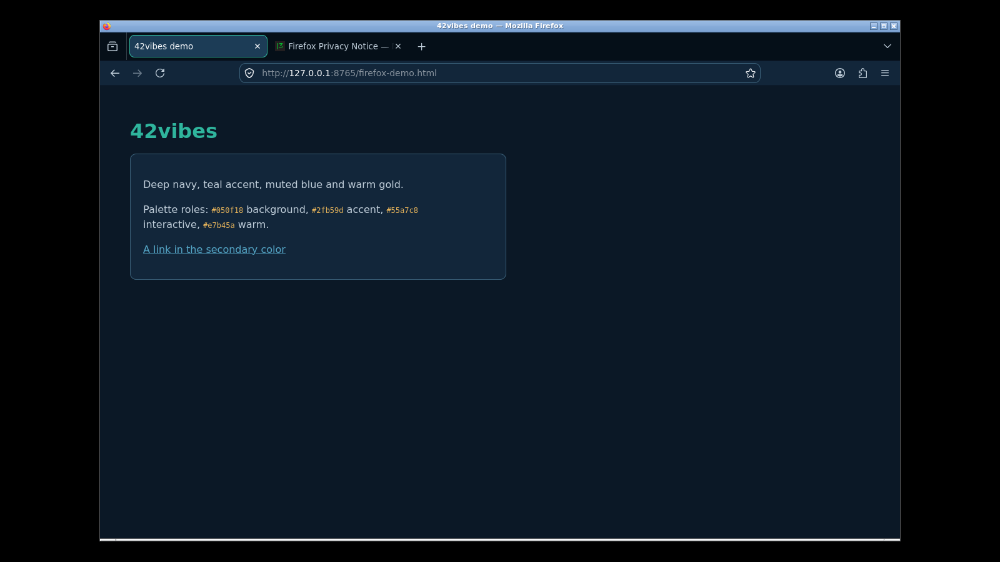
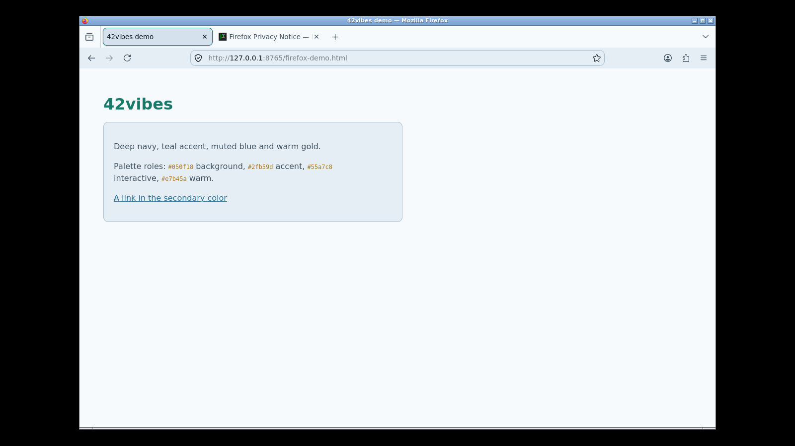

# 42vibes Firefox themes

**English** · [Deutsch](README.de.md)

Two separate Firefox themes — **42vibes Dark** and **42vibes Light** — built
from the shared [42vibes palette](vendor/palette.json).

Firefox can switch a theme's colors automatically: one theme may set both
`dark_theme` and `light_theme`, and Firefox applies whichever matches the
color scheme of the operating system or the browser setting. Shipping two
separate add-ons is a deliberate design decision — each variant has its own
identity, installs independently and keeps its own update channel — not a
technical necessity.

## Themes

| Folder | `color_scheme` | Gecko ID | Frame | Accent |
| --- | --- | --- | --- | --- |
| `firefox/42vibes-dark` | `dark` | `42vibes-dark@42vibes.local` | `#050f18` | `#2fb59d` |
| `firefox/42vibes-light` | `light` | `42vibes-light@42vibes.local` | `#f7fafc` | `#177a69` |

Both themes color the browser frame, toolbars, tabs, address bar, menus, sidebar
and the new-tab page. All values come from `semantic.*` and `ansi.*` in
`vendor/palette.json`. Each manifest sets
`browser_specific_settings.gecko.id` and `strict_min_version` ("115.0").

## Screenshots

**Visible evidence.** The two captures below show the frame, toolbars, tabs and
address bar of the dark and light theme with the palette colors as pixels on
screen. The new-tab page, popups (menus) and the sidebar are **not** visually
tested: no screenshot exists for them, and their colors are only checked as
manifest values.

**Capture protocol.** Real captures from Firefox 153.7 (Linux, Xvfb), theme
loaded as a temporary add-on through `about:debugging`. No automation session is
active, so the address bar is not marked.





## Installation

1. Open `about:debugging#/runtime/this-firefox` in Firefox.
2. Click **Load Temporary Add-on…**.
3. Select `firefox/42vibes-dark/manifest.json` (or the light variant).

Temporary add-ons are dropped when Firefox restarts. Building and loading the
themes locally is the primary way to use them; a listing on AMO is optional.

For a permanent install there are two paths:

* **Signed build (release and beta).** Signing is mandatory: release and beta
  Firefox only install signed add-ons. AMO signs both listed and
  self-distributed builds.
* **Unsigned self-install on ESR (optional).** Firefox ESR accepts an unsigned
  theme when `xpinstall.signatures.required=false` is set and the manifest
  carries an explicit `browser_specific_settings.gecko.id`; `strict_min_version`
  is "115.0" here. Both variants have such an ID
  (`42vibes-dark@42vibes.local`, `42vibes-light@42vibes.local`), so each keeps a
  stable identity across updates. This path removes a security guard: it is
  documented as an option, not as a recommendation.

## Contrast

The review measured two interactive surfaces as too weak. They are now derived
in `build.py` from palette roles: `border_strong` as a mix of `border` and
`interactive`, `surface_selected` as a mix of `surface_high` and `interactive`.
Measured contrast, dark and light checked separately:

| Pair | Dark | Light | Minimum |
| --- | --- | --- | --- |
| `toolbar_field_border` on `toolbar` | 3.36:1 | 3.30:1 | 3:1 |
| `popup_highlight` on `popup` | 3.12:1 | 3.32:1 | 3:1 |
| `popup_highlight_text` on `popup_highlight` | 4.71:1 | 4.78:1 | 4.5:1 |

`validate.py` checks exactly these pairs; inactive tabs against the toolbar are
not the pair that carries the affordance and are not part of that check.

## Limits

Firefox themes are not a full UI skin. They set colors for the frame, toolbars,
tabs, address bar, popups, sidebar and the new-tab page, and provide icons for
the add-on manager. They cannot restyle internal pages such as `about:preferences`,
rearrange toolbar and tab layout, or change the shape of tabs and buttons.

`userChrome.css` can go further, but Mozilla does not support it, it is not part
of this repository, and it breaks with UI changes. These themes are plain
WebExtensions and do not need it.

Chromium/Chrome is deliberately not covered.

## Publishing

Publishing on [addons.mozilla.org](https://addons.mozilla.org) (AMO) is
optional: the primary path is building the themes from this repository and
loading them locally. If you do want a listing, AMO is free and signs both
listed and self-distributed themes. `make package` writes the two ZIP files for
upload — no `web-ext` is required.

## Generated files

Every `manifest.json` and every icon is generated by `build.py`; do not edit
them by hand. Change colors in `vendor/palette.json` and the role mapping in
`build.py`, then rebuild.

`python3 build.py --out DIR` writes the same tree below `DIR` instead of
`firefox/`. `validate.py` uses that to build twice into throw-away directories
and compares both runs with the checked-in files, so validation never overwrites
an artifact.

Icons are rendered from a small SVG: the "42" glyph is drawn as blocks, so no
font is involved. If ImageMagick (`magick` or `convert`) is not installed, icon
rendering is skipped and reported as skipped — not as passed — and the committed
PNGs stay untouched.

## Development

```sh
make build      # regenerate manifests and icons
make validate   # layout, palette mapping, icons, docs, contrast, determinism
make package    # dist/42vibes-firefox-{dark,light}.zip
make check      # build + validate
```

`validate.py` exits 0 only if both temporary builds are byte-identical and match
the checked-in artifacts. It never writes to the repository. Requires Python
3.9+. ImageMagick and `zip` are optional.

## License

MIT, see [LICENSE](LICENSE).
